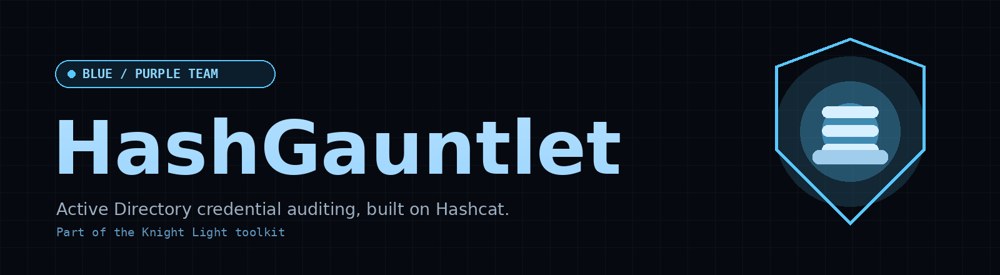
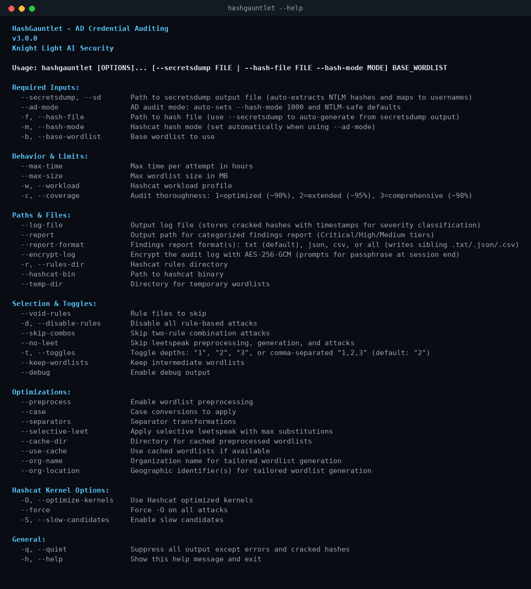

<p align="center">
  
</p>

<br>

## About the Project

HashGauntlet is an Active Directory credential auditing tool for blue and
purple teams. Feed it a domain's NTLM hashes and a base wordlist, and it runs
every account through a staged gauntlet of dictionary, rule, and hybrid mask
attacks, then reports which accounts fell, how fast, and what to do about it,
tiered by severity with remediation windows.

Built on Hashcat. Part of the Knight Light toolkit.

<details>
  <summary>Features Overview</summary>

<br>

- **Secretsdump ingestion**
  - Auto-extracts NTLM hashes from `secretsdump` output
  - Maps every cracked hash back to its SAMAccountName in the report

- **AD audit mode**
  - `--ad-mode` auto-selects hash mode 1000 (NTLM) with NTLM-safe defaults
  - Also accepts any Hashcat hash mode for non-AD audits

- **Staged attack gauntlet**
  - Dictionary, rule-based, and hybrid prepend/append mask attacks in priority order
  - Two-rule combination attacks for deeper coverage
  - Built-in leetspeak and toggle-case handling

- **Severity-tiered reporting**
  - Findings ranked by how quickly each account cracked, with remediation windows
  - Export as `txt`, `json`, `csv`, or all three (`--report-format`)

- **Tunable coverage**
  - `-c 1` optimized (~90%), `-c 2` extended (~95%), `-c 3` comprehensive (~98%)
  - Per-attack time and wordlist-size caps to keep long audits bounded

- **Optimized kernel safety**
  - Automatically splits wordlists by length so `-O` never silently skips
    passwords over the optimized-kernel limit

- **Wordlist preprocessing**
  - Case conversions, separator transforms, and selective leetspeak
  - Organization- and location-tailored wordlist generation

- **Interactive session controls**
  - Live keyboard commands to pause, resume, skip, finish, or kill a run
  - Persistent status bar with graceful cleanup on exit

- **Evidence handling**
  - Optional AES-256-GCM encryption of the audit log

- **Cross-platform**
  - Runs on Linux, Windows, and macOS

</details>

---

## Requirements

- [Hashcat](https://hashcat.net/hashcat/) installed and on your `PATH` (or pass `--hashcat-bin`)
- Rules are bundled in `rules/`; override with `--rules-dir` if you have your own
- Python 3.6+

---

## Install
```bash
git clone https://github.com/Nemorous/hashgauntlet.git
cd hashgauntlet
pip install .
```

---

## Usage


<i>For more usage information, please refer to [`EXAMPLES.md`](EXAMPLES.md)</i>

---

## Changelog

See [`CHANGELOG.md`](CHANGELOG.md)

---

## License

MIT [`LICENSE`](LICENSE)

---

## Contributions

PRs and issues welcome! Add new attack stages, rule sets, or report formats.

> Made with ☕ and 🔥 By d4rkfl4m3z

> Only run HashGauntlet against systems and hashes you are explicitly authorized to test.
